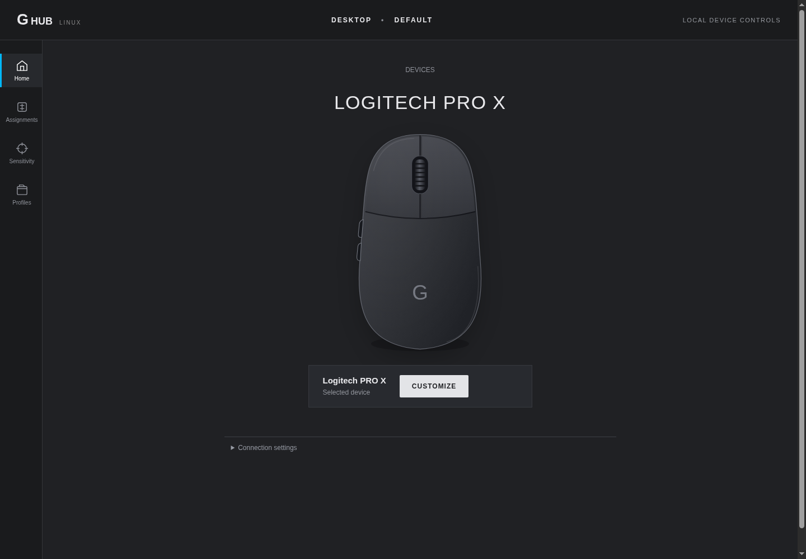
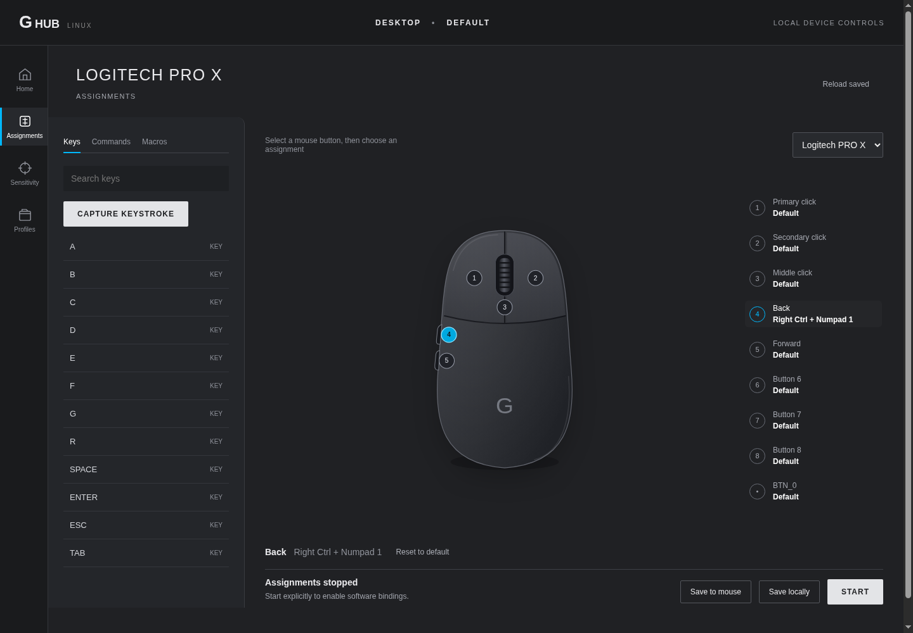
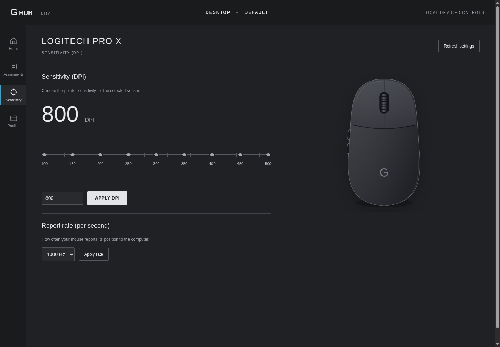

# G HUB Linux

**An unofficial Linux app for Logitech mice**, built with TypeScript. Configure sensitivity, remap buttons, create software macros, and save supported direct bindings to onboard memory through a G HUB-inspired interface.

This is an independent community project. It is **not affiliated with, endorsed by, or supported by Logitech**. Logitech and G HUB are trademarks of their respective owners.

## Screenshots

Screenshots of the running application with a connected mouse. The assignment shown uses a temporary test configuration; software playback is stopped.

### Home


### Button assignments


### Sensitivity


## Features

- Read and adjust supported DPI and polling-rate settings; sensitivity refreshes when the page opens.
- View battery information and switch between host and onboard modes where supported.
- Remap mouse buttons to keyboard keys, shortcuts, other mouse buttons, or no action.
- Capture physical keyboard keys, including arrow keys, left/right modifiers, and keypad keys.
- Create software macros with press, release, and delay events; run once, while held, or on a toggle.
- Save local mouse settings profiles with device compatibility checks.
- Save supported direct button bindings to onboard memory, with a backup and verified readback.
- Use the desktop interface, a local browser, or the command-line tools.

## Compatibility

Development and hardware checks have focused on the **Logitech PRO X SUPERLIGHT**. Other Logitech mice may work when they expose the supported HID++ features; support for every model is not guaranteed.

DPI, polling rate, battery, and onboard support depend on device firmware. Extended polling-rate and read-only extended DPI support are available through the backend/CLI. Onboard binding writes are restricted to the tested memory layout: model 1, profile format 4, 255-byte sectors, and the five normal button slots.

Software bindings and macros require the app to keep running. Onboard bindings can work without it; supported actions are mouse buttons, disable, or one keyboard key with optional modifiers. Firmware macros and chords with multiple ordinary keys are not supported. Stored bindings have been readback-verified on the development mouse; immediate firmware activation may require reconnecting the device.

Lighting, G-Shift, Lua scripting, firmware updates, pairing, cloud accounts, and automatic application switching are not implemented.

## Run from source

Requirements: Linux x86_64, Node.js 24+, npm, Chromium (`chromium`), g++, and Node development headers at `/usr/include/node`. There are no third-party npm dependencies.

```sh
git clone https://github.com/Edvvardas/GHUB-linux.git
cd GHUB-linux
npm run desktop
```

The launcher builds the small C++ native bridge and opens Chromium in an app window. To use a browser tab instead:

```sh
npm start
```

Open `http://127.0.0.1:8765`. Set `LGHUB_PORT` to change the port. The server listens on loopback and checks session tokens and origins for changes. Stop it with Ctrl+C to release software input handling.

### Device permissions

Run the app as your normal desktop user. Settings require read/write access to the appropriate `/dev/hidraw*` interface. Software remapping additionally requires read access to the mouse's `/dev/input/event*` node and access to `/dev/uinput`.

The included input helper installs a udev rule for **receiver `046d:c547` only**:

```sh
bash tools/setup-input.sh
```

It may request sudo to install the rule. It does not configure hidraw access. For another receiver, adapt the rule to its actual USB ID rather than granting access to all input devices. A separate uinput rule is provided in `tools/70-lghub-linux-uinput.rules`; the helper prints installation instructions if needed. Reconnect the receiver after changing rules.

### Assignments

1. Open **Assignments** and select the physical mouse input and source button.
2. Choose **Capture keystroke**, capture a key or shortcut, and confirm it; or create a macro.
3. Click **Start** to enable software bindings. **Stop** releases held outputs and the input grab.

**Save locally** stores configuration on the computer. **Save to mouse** writes supported direct assignments to the active onboard profile, switches to onboard mode, and stops software playback. Unsupported onboard actions are rejected before writing. An original-sector backup is saved before changes; writes are not automatically retried after an uncertain result.

Local configuration, profiles, and backups live in `$XDG_CONFIG_HOME/lghub-linux-ts`, normally `~/.config/lghub-linux-ts`.

## AppImage

Build a portable x86_64 package:

```sh
npm run appimage
chmod +x dist/GHub-Linux-0.1.0-x86_64.AppImage
./dist/GHub-Linux-0.1.0-x86_64.AppImage
```

Build requirements additionally include Python 3, `rsvg-convert`, and network access to fetch the pinned official Node, Electron, and AppImage tooling. Downloads are checksum-verified; their manifest is included in the package. Python is used only for packaging.

The AppImage bundles Node and Electron. It still needs normal desktop system libraries and device permissions. If FUSE is unavailable, launch with `--appimage-extract-and-run`. CLI options include `--version` and `--cli --help`. Cross-distribution compatibility has not been validated. Build outputs are excluded from Git.

## Command line

```sh
npm run build:native
npm run cli -- --help
npm run cli -- list
npm run cli -- status /dev/hidrawN --device-index 1
npm run cli -- dpi /dev/hidrawN --device-index 1 --set 1600
npm run cli -- rate /dev/hidrawN --device-index 1 --set 500
npm run cli -- assignments inputs
```

Replace the interface and device index with the values for your mouse. Some devices reject setting changes in onboard mode; select host mode first where required.

## Development

The application, HID++ implementation, settings, profiles, assignments, and macro engine are TypeScript. A small Node-API C++ bridge implements Linux device ioctls and virtual input creation. The renderer uses system fonts and custom SVG artwork; extracted Logitech fonts, icons, and application binaries are excluded from this repository.

```sh
npm run build:native
npm test
npm run test:browser
```

The browser smoke test uses Chromium, a temporary configuration directory, and the connected mouse's input inventory. It checks keyboard capture through the real UI and HTTP API without grabbing the mouse or injecting Linux input events. Opening Sensitivity reads current settings without changing them. Set `LGHUB_SCREENSHOT_DIR=docs/screenshots` to regenerate the README screenshots.

`.gitignore` excludes credentials, environment files, device backups, local profiles and assignments, research captures, dependencies, and generated packages. Review staged files before committing additional device diagnostics.
